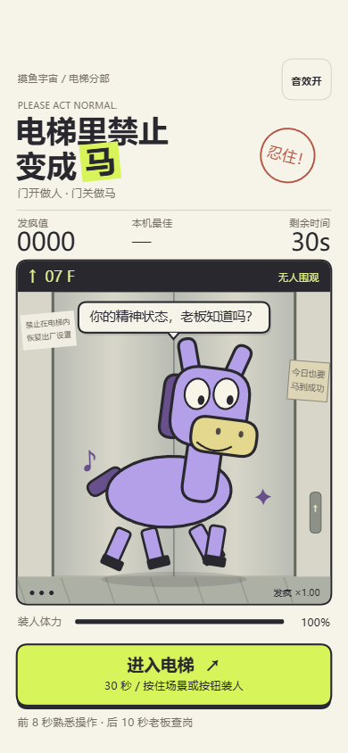

# 电梯里禁止变成马

原生 JavaScript + Canvas 2D 微信小游戏工程。直接导入源码，无需 npm install、构建游戏引擎或配置服务器。所有画面由代码绘制，音效随包提供，游戏过程不请求网络。



## 导入微信开发者工具

1. 解压工程，找到同时含有 `game.js`、`game.json`、`project.config.json` 的文件夹。
2. 打开微信开发者工具，选择「小游戏」并「导入项目」，目录选择上面的文件夹，开发模式为「小游戏」。不要导入成普通小程序。
3. AppID 填入你自己的 **微信小游戏 AppID**。它来自微信公众平台的小游戏账号，普通小程序 AppID 不能混用。导入对话框若不能覆盖工程值，先把 `project.config.json` 的 `appid` 字段改成你的 AppID。
4. 点击导入/编译。加载后应看到紫色小马、电梯和「进入电梯」按钮，点击即可游戏。在电脑模拟器里，用鼠标长按「按住装人」，松开即做马。
5. 用有权限的开发者账号登录后，可以使用工具「预览」做手机验证；具体可用能力由账号、AppID 和微信工具决定。

**AppID 说明：**工程预留值为 `touristappid`，它不是你的正式 AppID。本机微信开发者工具的实际 CLI 导入已返回「不存在此 AppID」，因此请替换为真实小游戏 AppID，不要把游客值当作已经验证可用的运行凭证。工程代码与 AppID 分离，不需要修改 JavaScript。

`project.config.json` 的关键字段：

```json
{
  "appid": "在这里填入你自己的小游戏AppID",
  "compileType": "game",
  "miniprogramRoot": "./"
}
```

AppID 是项目标识。本工程不需要 AppSecret，也不要把 AppSecret 填进客户端代码。

## 怎么玩

- 每局 30 秒。门关时松手，做马赚发疯值并回复体力。
- 开门前有 0.85 秒闪灯、文字与叮声预警。按住按钮装人，直到电梯门完全关上。
- 预警最后 0.36 秒才按下，可获得一次「极限装人」奖励 +60 分；每轮最多一次。
- 成功躲过一轮可获得 +30 分，连续成功会提高得分倍率，上限 2 倍。
- 每轮被看见最多扣一次生命，累计 3 次暴露结束。一直按住会耗尽体力，也会结束。
- 暂停、切到后台和尺寸变化会冻结游戏；返回后需点击继续，恢复有 1 秒反应宽限。
- 最高分和音效开关保存在本机。清除微信开发者工具缓存或卸载会丢失本地纪录。
- 「挑战好友」调用微信原生分享面板；「复制战绩」复制本局文字。分享能力需在真实 AppID 和可用环境下验证，不会伪造好友榜或分享成功回调。

## 工程结构

```text
game.js                 微信启动入口
game.json               竖屏与状态栏配置
project.config.json     开发者工具导入配置
src/config.js           时长、体力、分数等参数
src/engine.js           玩法、状态机、判定与结算
src/renderer.js         高分屏 Canvas 绘图、屏幕适配、触控命中
src/application.js      微信触控、前后台、存储与分享
src/audio.js            内置音效播放器
assets/audio/*.wav      4 个原创合成短音效
tests/*.test.js         核心规则与微信适配层检查
```

## 修改与本地检查

要改每局时长、难度或积分，修改 `src/config.js`；换颜色与角色外观，修改 `src/renderer.js`。规则层不依赖微信环境，安装 Node.js 18 或更高版本后，可在工程目录运行：

```shell
node --test tests/engine.test.js tests/application.test.js
```

不需要先安装依赖。开发者工具打包时会忽略测试文件、说明文档与 package.json。

## 当前交付范围

已实现完整本地单人游戏。未接入广告、付费、服务器、云端排行榜或开放数据域；不需要微信登录、用户头像或额外敏感权限。要上架还需使用你自己的小游戏账号/AppID，完成微信平台要求的配置、真机验收和发布流程。

验证结果及尚未完成的微信环境验证见 `验收记录.md`。

## 平台参考

- [微信官方小游戏示例工程](https://github.com/wechat-miniprogram/minigame-demo)
- [微信小游戏开发文档](https://developers.weixin.qq.com/minigame/dev/guide/)
- [微信开发者工具项目配置](https://developers.weixin.qq.com/miniprogram/dev/devtools/projectconfig.html)
